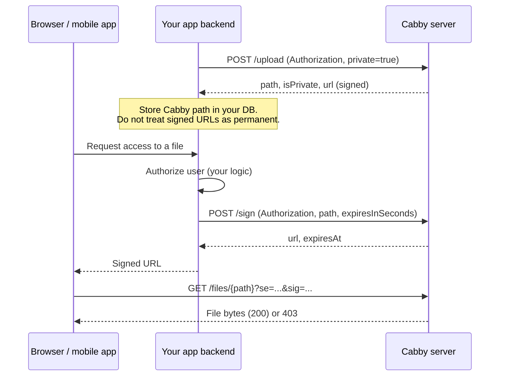

# Private Files & App Integration

This document describes how applications integrate with Cabby's private file feature.
Use it as the reference when implementing upload, access control, or signed URL
handling in a client app.

Cabby has **no SDK**. Integration is HTTP-only via the REST API.

## Summary

- Upload with `private=true` to mark a file as private.
- Private files **cannot** be read via a plain `/files/{path}` URL.
- Access requires a **signed URL** with query params `se` (expiry) and `sig`
  (HMAC signature), similar to Azure SAS tokens.
- **Your app backend** calls Cabby to upload and to mint signed URLs.
- **Your app frontend** receives time-limited signed URLs from your backend —
  never the Cabby write/signing secret.

## Architecture



## Environment variables (Cabby server)

| Variable | Required | Description |
|----------|----------|-------------|
| `WRITE_AUTH_TOKEN` | Yes (for upload/delete/sign) | Bearer token for write operations |
| `SIGNED_URL_SECRET` | Recommended | HMAC secret for URL signing. Fallback order: `SIGNED_URL_SECRET` → `WRITE_AUTH_TOKEN` → `UPLOAD_AUTH_SECRET` |
| `SIGNED_URL_DEFAULT_TTL` | No | Default signed URL lifetime in seconds. Default: `3600` (1 hour) |

## API reference

### Upload a private file

```http
POST /upload
Authorization: Bearer <WRITE_AUTH_TOKEN>
Content-Type: multipart/form-data
```

| Field | Type | Description |
|-------|------|-------------|
| `file` | File | File bytes |
| `path` | string | Storage path relative to `FILE_STORAGE_PATH` (e.g. `users/123/doc.pdf`) |
| `private` | string | Set to `true`, `1`, or `on` to mark the file private |

**Success response (private file):**

```json
{
  "success": true,
  "path": "users/123/doc.pdf",
  "url": "https://cabby.example.com/files/users/123/doc.pdf?se=1735127056&sig=...",
  "isPrivate": true,
  "revision": "1735123456789",
  "mimeType": "application/pdf",
  "size": 12345
}
```

The upload response includes an initial signed URL. **Store `path` in your database**,
not the signed URL as a permanent link. Mint fresh URLs via `POST /sign` when users
need access.

### Generate a signed URL

```http
POST /sign
Authorization: Bearer <WRITE_AUTH_TOKEN>
Content-Type: application/json
```

**Request body (document, no transforms):**

```json
{
  "path": "users/123/doc.pdf",
  "expiresInSeconds": 900
}
```

**Request body (image with transforms — `size` and `format` must match the GET URL):**

```json
{
  "path": "users/123/avatar.jpg",
  "expiresInSeconds": 900,
  "size": "180x240",
  "format": "webp"
}
```

| Field | Required | Description |
|-------|----------|-------------|
| `path` | Yes | Cabby storage path (must be a private file) |
| `expiresInSeconds` | No | TTL; defaults to `SIGNED_URL_DEFAULT_TTL` |
| `size` | No | Image transform: e.g. `180x240`. Must match the eventual GET request |
| `format` | No | Image transform: e.g. `webp`. Must match the eventual GET request |

**Success response (document):**

```json
{
  "success": true,
  "path": "users/123/doc.pdf",
  "url": "https://cabby.example.com/files/users/123/doc.pdf?se=1735127956&sig=...",
  "expiresAt": 1735127956,
  "expiresInSeconds": 900
}
```

**Success response (image with transforms):**

```json
{
  "success": true,
  "path": "users/123/avatar.jpg",
  "url": "https://cabby.example.com/files/users/123/avatar.jpg?size=180x240&format=webp&se=1735127956&sig=...",
  "expiresAt": 1735127956,
  "expiresInSeconds": 900
}
```

**Errors:**

| Status | Condition |
|--------|-----------|
| `401` | Missing or invalid `Authorization` |
| `400` | File is not private (use public URL instead) |
| `500` | Signing secret not configured |

### Mark existing files private (migration)

Use this after deploy to flip privacy on files that already exist on disk.
No re-upload required. Cap: **500 paths per request** — chunk larger lists.

```http
POST /privacy
Authorization: Bearer <WRITE_AUTH_TOKEN>
Content-Type: application/json
```

**Single path:**

```json
{ "private": true, "path": "users/123/doc.pdf" }
```

**Batch:**

```json
{
  "private": true,
  "paths": ["users/1/a.pdf", "users/2/b.jpg", "users/3/c.png"]
}
```

You may send both `path` and `paths`; they are merged. Set `"private": false`
to clear the private flag (restore public GET).

**Success response:**

```json
{
  "success": true,
  "private": true,
  "updated": ["users/1/a.pdf"],
  "unchanged": ["users/2/b.jpg"],
  "missing": ["users/3/gone.pdf"],
  "invalid": []
}
```

| Field | Meaning |
|-------|---------|
| `updated` | Privacy flag changed |
| `unchanged` | Already matched the requested state |
| `missing` | Path not present as a file on disk (no metadata written) |
| `invalid` | Path failed normalization / traversal checks |

**Migration recipe:**

1. Query your app DB for Cabby storage paths that should be private.
2. Chunk into batches of ≤500.
3. `POST /privacy` with `private: true` for each chunk.
4. After that, requests that **reach Cabby** without a valid signature return `403`.
   Clients must use `POST /sign` for access.
5. **Purge edge/browser caches for each migrated path.** Cabby cannot purge
   browser caches, shared proxy caches, or CDNs. Formerly public responses may
   remain readable from those caches for up to **31536000 seconds** (one year)
   when they were served with `Cache-Control: public, max-age=31536000, immutable`
   (typical for `?v=` URLs). The new `403` applies only after the request hits
   Cabby.

**Cache purge by deployment target** (use the mechanism you already operate):

| Layer | Default Cabby deploy docs | What to do after `POST /privacy` |
|-------|---------------------------|----------------------------------|
| Cabby origin | Always | Enforces private reads immediately for uncached requests |
| Browser | N/A | Hard refresh or wait out `max-age`; Cabby cannot clear client caches |
| Nginx (see [deployment.md](./deployment.md)) | Example config has **no** `proxy_cache` | If you added `proxy_cache`, purge those cache keys/files with your existing nginx cache tooling (e.g. `proxy_cache_purge` when configured, or delete the on-disk cache zone entries for the migrated URLs). If you did not enable proxy caching, skip |
| Cloudflare / other CDN | Not configured by Cabby | Purge each migrated URL (or a prefix) via that provider’s dashboard or Cache Purge API |
| Traefik / Caddy | TLS reverse proxy only in docs | Same as nginx: only if you configured a caching middleware/plugin |

Do not assume a purge API exists on Cabby itself — there is none.

```bash
curl -X POST "$CABBY_URL/privacy" \
  -H "Authorization: Bearer $CABBY_WRITE_TOKEN" \
  -H "Content-Type: application/json" \
  -d '{"private":true,"paths":["users/1/a.pdf","users/2/b.jpg"]}'
```

### Read a file

```http
GET /files/{path}[?size=...&format=...&se=...&sig=...]
```

| File type | URL required |
|-----------|--------------|
| Public | Plain `/files/{path}` (optional `?v=` for cache-busting) |
| Private | Must include valid `se` and `sig`. Optional `size`/`format` for images |

**Private file errors:**

| Status | Body | Cause |
|--------|------|-------|
| `403` | `Forbidden` | Missing or invalid signature |
| `403` | `Signed URL has expired` | `se` is in the past |
| `404` | `File not found` | Path does not exist |
| `500` | `SIGNED_URL_SECRET (or WRITE_AUTH_TOKEN) is not configured` | Signing secret not configured on the Cabby server |

Private file responses use `Cache-Control: private, no-store`.

## Signed URL format

Query parameters on the file URL:

| Param | Name | Description |
|-------|------|-------------|
| `se` | signed expiry | Unix timestamp (seconds) when the URL expires |
| `sig` | signature | HMAC-SHA256, base64url-encoded |
| `size` | (optional) | Image resize, e.g. `180x240` — included in signature |
| `format` | (optional) | Image format, e.g. `webp` — included in signature |
| `v` | (optional) | Source revision for cache-busting; not part of signature |

**Signature payload** (newline-separated):

```text
GET
{normalized-storage-path}
{expiresAt}
{size or empty string}
{format or empty string}
```

**Algorithm:** `HMAC-SHA256(payload, SIGNED_URL_SECRET)` → base64url digest.

The storage path in the signature is the **normalized relative path** (e.g.
`users/123/doc.pdf`), not URL-encoded segments.

Implementation reference: `src/server/signed-url.ts`.

## What your app should implement

### 1. Server-side Cabby client

Wrap Cabby HTTP calls in your backend. Example:

```typescript
const CABBY_URL = process.env.CABBY_URL
const CABBY_TOKEN = process.env.CABBY_WRITE_TOKEN

async function cabbySign(path: string, expiresInSeconds = 900) {
  const res = await fetch(`${CABBY_URL}/sign`, {
    method: 'POST',
    headers: {
      Authorization: `Bearer ${CABBY_TOKEN}`,
      'Content-Type': 'application/json',
    },
    body: JSON.stringify({ path, expiresInSeconds }),
  })
  const data = await res.json()
  if (!data.success) throw new Error(data.error ?? 'sign failed')
  return data as { url: string; expiresAt: number }
}
```

### 2. Your own access endpoint

Expose something like `GET /api/files/:id` that:

1. Loads the file record from **your** database (includes Cabby `path`, `isPrivate`).
2. Checks **your** authorization (user owns file, has role, etc.).
3. If private: calls Cabby `POST /sign`, returns `{ url, expiresAt }`.
4. If public: returns the stable public Cabby URL.

### 3. Database fields to store

| Field | Example | Notes |
|-------|---------|-------|
| `cabbyPath` | `users/123/invoice.pdf` | Required — the Cabby storage path |
| `isPrivate` | `true` | Mirror Cabby's private flag |
| `revision` | `1735123456789` | Optional — from upload response `revision` |

Do **not** store signed URLs as long-lived assets. They expire.

### 4. Frontend usage

Use the signed URL returned by your backend:

```html

```

```typescript
const { url } = await fetch('/api/files/abc123').then((r) => r.json())
window.open(url)
```

Refresh before expiry if the user keeps the page open (call your backend again).

## Public vs private

| | Public | Private |
|---|--------|---------|
| Upload | omit `private` or `private=false` | `private=true` |
| Direct GET | Works | `403` without signature |
| URL stability | Stable (use `?v=` after overwrite) | Expires; re-sign via `POST /sign` |
| Auth on read | None | `se` + `sig` query params |
| Who mints URLs | N/A | Your backend via `POST /sign` |

## Image transforms on private files

If the client needs a resized/converted image, pass `size` and/or `format` to
`POST /sign` **and** use the same values in the GET URL. The signature binds to
those transform params.

Example signed URL:

```text
/files/photos/cat.jpg?size=400x300&format=webp&se=1735127956&sig=...
```

## Security rules

1. **Never** expose `WRITE_AUTH_TOKEN` or `SIGNED_URL_SECRET` to browsers or mobile apps.
2. **Never** call `POST /sign` from the client — always from your backend.
3. Cabby does not enforce per-user ACLs. **Your app** decides who gets a signed URL.
4. Signed URLs are bearer tokens until expiry. Use short TTLs for sensitive content.
5. There is no revocation API — shorter TTLs reduce exposure if a URL leaks.

## Metadata storage (operators)

Private flags are stored on the Cabby server at:

```text
{FILE_STORAGE_PATH}/.cabby/metadata/{path}.json
```

Example: `{ "private": true }` for path `users/123/doc.pdf`.

This directory is excluded from file listings. Deleting a file removes its metadata.

## curl examples

**Upload private:**

```bash
curl -X POST "$CABBY_URL/upload" \
  -H "Authorization: Bearer $CABBY_WRITE_TOKEN" \
  -F "file=@./invoice.pdf" \
  -F "path=users/123/invoice.pdf" \
  -F "private=true"
```

**Sign:**

```bash
curl -X POST "$CABBY_URL/sign" \
  -H "Authorization: Bearer $CABBY_WRITE_TOKEN" \
  -H "Content-Type: application/json" \
  -d '{"path":"users/123/invoice.pdf","expiresInSeconds":900}'
```

**Mark existing files private:**

```bash
curl -X POST "$CABBY_URL/privacy" \
  -H "Authorization: Bearer $CABBY_WRITE_TOKEN" \
  -H "Content-Type: application/json" \
  -d '{"private":true,"paths":["users/123/invoice.pdf"]}'
```

**Download (use URL from sign response):**

```bash
curl -L "$SIGNED_URL" -o invoice.pdf
```

## Related docs

- [README](../README.md) — general API overview
- [deployment.md](./deployment.md) — production setup
